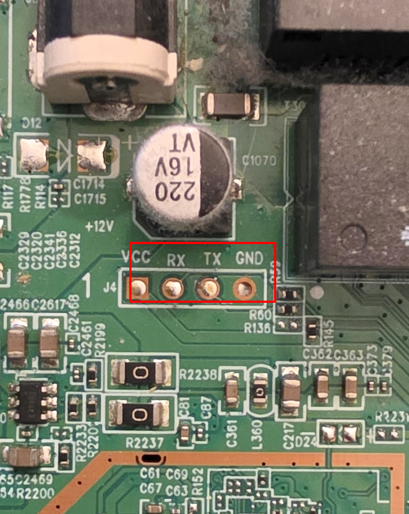

# Root access via UART serial (the hardware path)

> **Most people don't need this.** The easiest way to get root is the
> [web admin method](08-web-to-root-exploit.md) — no hardware required.
> This page documents the UART serial path for reference, recovery, or if
> the web method doesn't work on your firmware version.

This method uses a USB-TTL serial adapter (~€4) wired to the on-board UART
header. It requires opening the case and, depending on the header type, a few
drops of solder.



## What you need

- **USB-TTL serial adapter**, 3.3 V logic. Any CH340G / CP2102 / FT232 module is
  fine. If using a CH340G module with a voltage-select jumper, **set it to 3V3**
  (not 5V — a 5 V TX will overvolt the router's RX).
- 3 dupont wires (female-female, or whatever matches your adapter).
- A multimeter (optional but recommended — verify the adapter's TX idles at ~3.3 V
  before connecting it to the router).
- A soldering iron (optional, depending on the header — see below).
- Phillips screwdriver + plastic opening pick.

## Pinout

The UART header is **silkscreened on the main PCB** as `J4`, four pads in a line,
labeled from left to right:

```
VCC   RX   TX   GND
 ○     ○    ○     ○     ← J4
```

On the observed unit the pads are through-holes but with no pin header
populated. Either solder a 4-pin header on, or hand-hold three dupont wires
in the holes during boot (good enough to enter failsafe but fiddly).

Wiring (TX and RX **cross over**):

| Pad on router `J4` | → | USB-TTL adapter |
|---|---|---|
| `GND` (rightmost) | → | `GND` |
| `TX` (3rd from left) | → | `RXD` |
| `RX` (2nd from left) | → | `TXD` |
| `VCC` (leftmost) | **do not connect** | — |

The router has its own power supply. Connecting the adapter's VCC is unnecessary
and risks backfeeding.

## Serial parameters

- **115200** baud
- **8N1** (8 data bits, no parity, 1 stop bit)
- No flow control

Any serial terminal works (PuTTY, screen, minicom). On Windows, PuTTY in
"Serial" mode pointed at the COM port that appears when you plug in the
adapter is the simplest.

## Procedure

1. **Wire up as above.** Router still powered off.
2. **Open your serial terminal** on the adapter's COM port at 115200 8N1.
3. **Plug in the router's power.** The boot log should start scrolling in the
   terminal within 1-2 seconds. If you see nothing: check TX/RX, GND, baud rate.
4. Within ~10-15 seconds you'll see the boot log print:

   ```
   Press the [f] key and hit [enter] to enter failsafe mode
   Press the [1], [2], [3] or [4] key and hit [enter] to select the debug level
   ```

   **Immediately type `f` then Enter.** You have about a 5-second window.
   If you miss it, the device boots normally and shows a login prompt — just
   `reboot` and try again.

5. After a few more kernel messages you'll see the failsafe banner and get a
   root shell with no password:

   ```
   ================= FAILSAFE MODE active =================
   ...
   root@(none):/#
   ```

## Making root persistent

By default, the root account in the stock firmware has a known hash in
`/etc/shadow` but `/bin/false` as its shell, which blocks SSH login even
if you set a password. Fix both while you're in failsafe:

```sh
# Mount the writable overlay (failsafe runs from squashfs read-only)
mount_root

# Set a root password you'll remember, and give root a real shell
printf 'YourPasswordHere\nYourPasswordHere\n' | passwd root
sed -i 's#^\(root:.*\):/bin/false$#\1:/bin/ash#' /etc/passwd

sync
reboot
```

After reboot, you can SSH in from your LAN:

```sh
ssh root@192.168.1.100           # or whatever IP the router has
# password: whatever you set above
```

That's it — you now have root SSH over the network, no serial required for
future sessions. Close the case, store the USB-TTL adapter.

## Notes / gotchas

- The **Reset / WPS button** at boot does **not** enter OpenWrt failsafe on
  this device — the U-Boot stage intercepts those buttons first and latches
  the device into its own web-recovery mode (power LED solid,
  `http://192.168.1.1`, a locally-administered MAC). Serial is the only way
  to reach OpenWrt failsafe.
- At the normal `reboot` command the MediaTek Wi-Fi driver prints a kernel
  oops about `rt_pci_shutdown` ("Fatal exception: panic in 5 seconds") —
  this is cosmetic, the panic itself triggers the reboot and it proceeds
  normally.
- A sealed U-Boot menu is also available on the serial console at power-on
  (`Hit any key to stop autoboot`), with options for firmware upload etc.
  We don't need it for failsafe but it's there if you ever need recovery.
